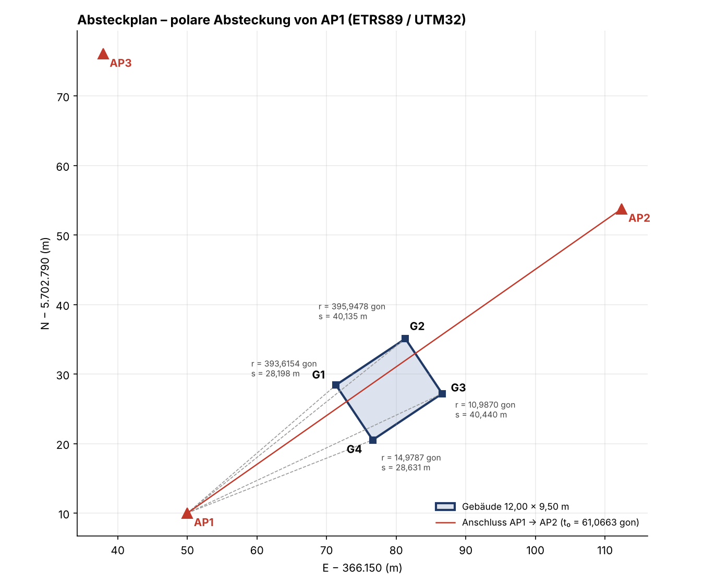
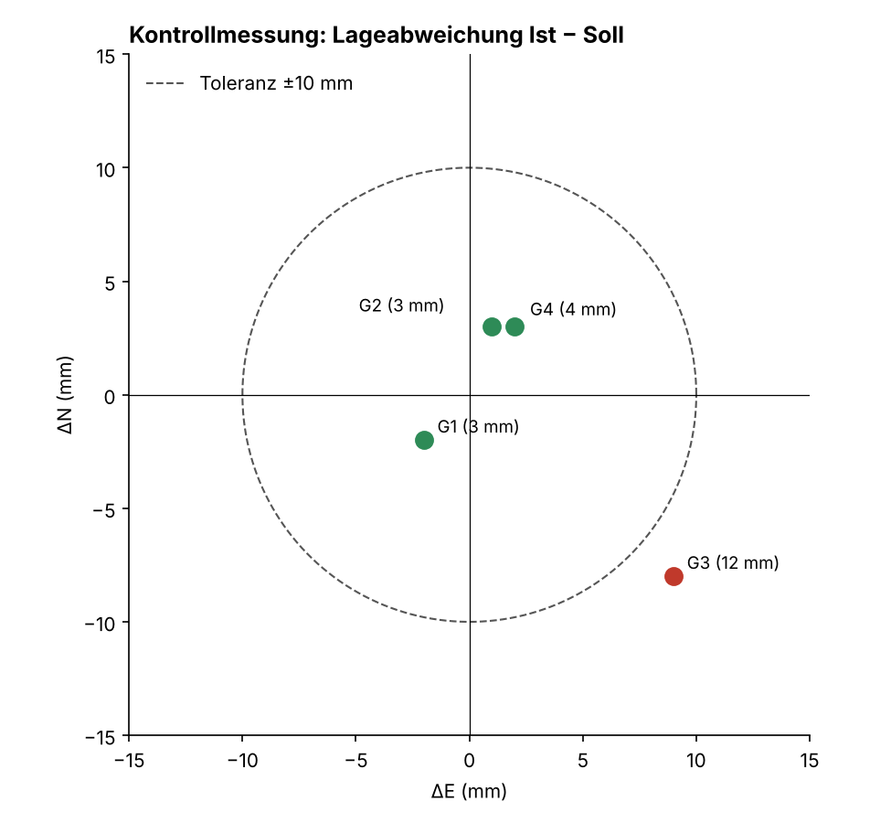
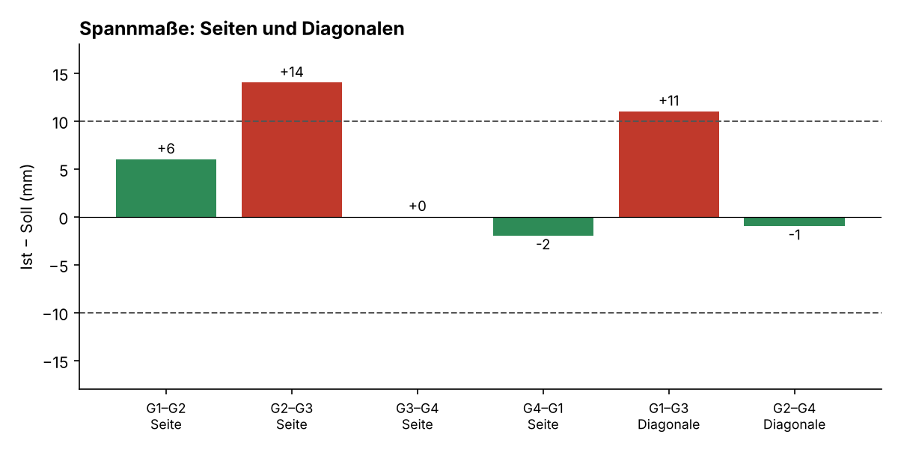

# Setting-Out Survey – Detached House (Polar Method, Control and Protocol)

[English](#setting-out-survey--detached-house-polar-method-control-and-protocol) | [Deutsch](#deutsch)

Where exactly must the building corners be marked on site? This project shows the full **setting-out workflow (Absteckung)** for a **detached house (12.00 × 9.50 m)**: **control points and design coordinates** → **setting-out data with the polar method** (bearing, horizontal direction, distance) from a total station set-up → **control measurement** with a **±10 mm tolerance check** → **sides and diagonals** → **DXF setting-out plan**, point file for the total station and a **setting-out protocol** – the typical tasks of a surveying engineer on a building site.



---

## Key results

| | |
|---|---|
| Project | Fictitious example: detached house 12.00 × 9.50 m, ETRS89 / UTM zone 32N (EPSG:25832) |
| Set-up | Station **AP1**, orientation to **AP2** (t₀ = 61.0663 gon), orientation check on **AP3** |
| Setting-out points | **4** building corners G1–G4, design height 95.850 m (top of base slab) |
| Control measurement | **3 of 4** points within ±10 mm, mean position deviation **5.5 mm** |
| Out of tolerance | **G3** (12 mm) → re-stake; side G2–G3 (+14 mm) and diagonal G1–G3 (+11 mm) affected |
| Heights | all within **±3 mm** |

**Setting-out data from AP1**

| Point | Direction r (gon) | Distance s (m) |
|---|---|---|
| G1 | 393.6154 | 28.198 |
| G2 | 395.9478 | 40.135 |
| G3 | 10.9870 | 40.440 |
| G4 | 14.9787 | 28.631 |

**Interpretation:** three corners are within the tolerance; G3 is 12 mm off, which is also visible in the side G2–G3 and the diagonal G1–G3, while the other sides and the second diagonal are within ±6 mm. **Recommended measures:** correct G3 (ΔE −9 mm, ΔN +8 mm), measure the side and diagonal again and release the batter boards / base slab only after a successful check.

| | |
|---|---|
|  |  |

---

## Workflow

| Step | Content |
|---|---|
| **1 Control points and design** | 3 control points (AP1–AP3) and 4 building corners from the design (corner G1, bearing of the long side 62.5000 gon, 12.00 × 9.50 m) |
| **2 Setting-out data** | Bearing t, horizontal direction r = t − t₀ (orientation to AP2) and horizontal distance s for every point; orientation check on AP3 |
| **3 Control measurement** | As-built coordinates of the marked points; ΔE, ΔN, position deviation and ΔH; tolerance ±10 mm |
| **4 Sides and diagonals** | Design vs. measured distances of the 4 sides and 2 diagonals |
| **5 Export** | DXF plan (layers: control points, building, setting-out points, rays, dimensions, text), point file for the total station, Excel, CSV, charts and a 2-page setting-out protocol in German |

## Limitations

- Fictitious example: coordinates and measured values are assumptions (the control measurement is simulated)
- Tolerance ±10 mm as a typical value for building setting-out; project-specific tolerances (e.g. DIN 18202) must be agreed
- No instrument data import; in practice the control measurement comes from the total station

---

## Repository structure

```
Setting-Out-Survey-Building/
├── notebooks/
│   └── absteckung_einfamilienhaus.ipynb
├── images/
│   ├── 01_Absteckplan.png
│   ├── 02_Kontrolle_Abweichungen.png
│   └── 03_Spannmasse.png
├── results/
│   ├── Absteckprotokoll_Einfamilienhaus.pdf   # setting-out protocol (German)
│   ├── absteckplan_einfamilienhaus.dxf        # setting-out plan for CAD
│   ├── absteckung_einfamilienhaus.xlsx        # all tables
│   ├── punktdatei_tachymeter.txt              # point file (Pkt E N H)
│   ├── absteckdaten.csv
│   ├── kontrolle.csv
│   ├── spannmasse.csv
│   └── kennzahlen.csv
├── requirements.txt
├── LICENSE
└── README.md
```

The notebook runs in Google Colab or locally; all input data are defined in the notebook, no download is needed.

## Tools

Python · pandas · NumPy · ezdxf · Matplotlib · Excel · Google Colab

## Data sources

Fictitious example project created for this portfolio. No real project or client data.

## License

Code: MIT License – see [LICENSE](LICENSE)

---
---

# Deutsch

[English](#setting-out-survey--detached-house-polar-method-control-and-protocol) | [Deutsch](#deutsch)

Wo genau müssen die Gebäudeecken auf der Baustelle markiert werden? Dieses Projekt zeigt den vollständigen **Ablauf einer Absteckung** für ein **Einfamilienhaus (12,00 × 9,50 m)**: **Festpunkte und Sollkoordinaten** → **Absteckdaten im polaren Verfahren** (Richtungswinkel, Horizontalrichtung, Strecke) vom Tachymeterstandpunkt → **Kontrollmessung** mit **Toleranzprüfung ±10 mm** → **Seiten und Diagonalen** → **DXF-Absteckplan**, Punktdatei für das Tachymeter und **Absteckprotokoll** – die typischen Aufgaben eines Vermessungsingenieurs auf der Baustelle.


---

## Zentrale Ergebnisse

| | |
|---|---|
| Projekt | Fiktives Beispiel: Einfamilienhaus 12,00 × 9,50 m, ETRS89 / UTM Zone 32N (EPSG:25832) |
| Standpunkt | **AP1**, Anschluss **AP2** (t₀ = 61,0663 gon), Orientierungskontrolle auf **AP3** |
| Absteckpunkte | **4** Gebäudeecken G1–G4, Sollhöhe 95,850 m (OK Bodenplatte) |
| Kontrollmessung | **3 von 4** Punkten innerhalb ±10 mm, mittlere Lageabweichung **5,5 mm** |
| Außerhalb der Toleranz | **G3** (12 mm) → nachstecken; Seite G2–G3 (+14 mm) und Diagonale G1–G3 (+11 mm) betroffen |
| Höhen | alle innerhalb **±3 mm** |

**Absteckdaten von AP1**

| Punkt | Richtung r (gon) | Strecke s (m) |
|---|---|---|
| G1 | 393,6154 | 28,198 |
| G2 | 395,9478 | 40,135 |
| G3 | 10,9870 | 40,440 |
| G4 | 14,9787 | 28,631 |

**Interpretation:** Drei Ecken liegen innerhalb der Toleranz; G3 weicht um 12 mm ab, was auch in der Seite G2–G3 und der Diagonale G1–G3 sichtbar ist, während die übrigen Seiten und die zweite Diagonale innerhalb von ±6 mm liegen. **Maßnahmen:** G3 korrigieren (ΔE −9 mm, ΔN +8 mm), Seite und Diagonale erneut messen und Schnurgerüst bzw. Bodenplatte erst nach erfolgreicher Kontrolle freigeben.

---

## Arbeitsablauf

| Schritt | Inhalt |
|---|---|
| **1 Festpunkte und Planung** | 3 Festpunkte (AP1–AP3) und 4 Gebäudeecken aus der Planung (Ecke G1, Richtungswinkel der Längsseite 62,5000 gon, 12,00 × 9,50 m) |
| **2 Absteckdaten** | Richtungswinkel t, Horizontalrichtung r = t − t₀ (Anschluss AP2) und Horizontalstrecke s je Punkt; Orientierungskontrolle auf AP3 |
| **3 Kontrollmessung** | Ist-Koordinaten der markierten Punkte; ΔE, ΔN, Lageabweichung und ΔH; Toleranz ±10 mm |
| **4 Seiten und Diagonalen** | Soll- und Ist-Strecken der 4 Seiten und 2 Diagonalen |
| **5 Export** | DXF-Plan (Layer: Festpunkte, Gebäude, Absteckpunkte, Strahlen, Bemaßung, Text), Punktdatei für das Tachymeter, Excel, CSV, Diagramme und Absteckprotokoll mit 2 Seiten |

## Einschränkungen

- Fiktives Beispiel: Koordinaten und Messwerte sind Annahmen (die Kontrollmessung ist simuliert)
- Toleranz ±10 mm als typischer Wert für Gebäudeabsteckungen; projektbezogene Toleranzen (z. B. DIN 18202) sind zu vereinbaren
- Kein Import von Instrumentendaten; in der Praxis kommt die Kontrollmessung vom Tachymeter

---

## Werkzeuge

Python · pandas · NumPy · ezdxf · Matplotlib · Excel · Google Colab

## Datenquellen

Fiktives Beispielprojekt für dieses Portfolio. Keine echten Projekt- oder Kundendaten.

## Lizenz

Code: MIT-Lizenz – siehe [LICENSE](LICENSE)
